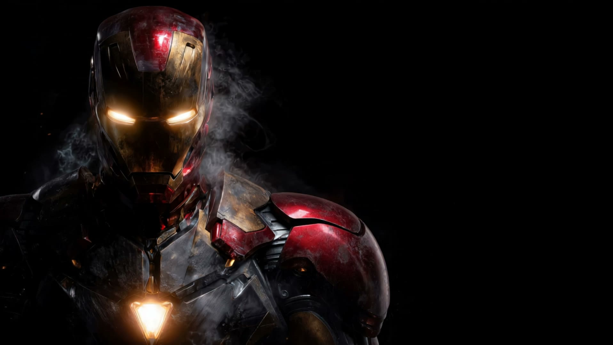

# Stark Industries — Iron Man Mark LXXXV

A high-performance cinematic web experience showcasing the Iron Man Mark LXXXV suit with interactive scroll-driven canvas frame sequences, real-time audio playback, HUD overlays, and smooth scrolling physics.



---

## ⚡ Tech Stack

- **Framework**: [Next.js 16](https://nextjs.org/) (App Router, Turbopack)
- **Library**: [React 19](https://react.dev/)
- **Styling**: [Tailwind CSS v4](https://tailwindcss.com/)
- **Animation & Motion**: [Framer Motion](https://www.framer.com/motion/)
- **Smooth Scrolling**: [Lenis](https://github.com/darkroomengineering/lenis)
- **Icons**: [@phosphor-icons/react](https://phosphoricons.com/)
- **Typography**: [Geist](https://vercel.com/font)

---

## 🚀 Getting Started

### Prerequisites

- Node.js 18.18+ or 20+
- npm, pnpm, or yarn

### Installation

```bash
# Clone the repository
git clone https://github.com/sussybakaingit/Iron_Man_Web.git
cd Iron_Man_Web

# Install dependencies
npm install
```

### Running Locally

```bash
npm run dev
```

Open [http://localhost:3000](http://localhost:3000) in your browser.

---

## 🛠️ Build & Production

To verify or test a production build locally:

```bash
# Build the application
npm run build

# Start the production server
npm run start
```

---

## 🌐 Deployment

### Deploy to Vercel (Recommended)

1. Push your repository to GitHub (or import `sussybakaingit/Iron_Man_Web`).
2. Go to [Vercel](https://vercel.com/new).
3. Select the `Iron_Man_Web` repository.
4. Next.js preset will be automatically detected.
5. Click **Deploy**.

### Deploy to Netlify / Other Hosts

- **Build Command**: `npm run build`
- **Output Directory**: `.next` (or use the Next.js Runtime plugin)
